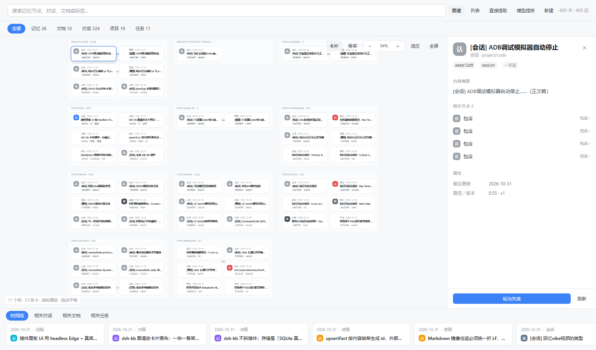

# @myremme/dsh-kb

**DeepSeek Harness 的本地长期记忆库。** 把每次会话里"想明白的事"沉淀成不可变的事实卡，让下一次会话不必从零开始。

零外部依赖：只用 `node:sqlite` 和 `node:zlib`。整个库是一个 SQLite 文件，随你备份、迁移、用 `sqlite3` 直接打开看。

```
               fact 账本（唯一真相）
               一行 = 一条不可变事实卡
                          │ 投影（全部可重建）
         ┌────────────────┼────────────────┐
         ▼                ▼                ▼
    node 骨架树      edge 关系图        FTS 索引
    多归属、摘要=缓存  1跳扩展、演化链    bigram + 覆盖率精排
```

详细取舍见 [docs/DESIGN.md](docs/DESIGN.md)。

---

## 装

```bash
# 本机开发：先打包，再装进 profile（真实副本，不是软链）
cd D:/Code/dsh-kb && pnpm pack --pack-destination dist
cd ~/.dsh/profiles/desktop && pnpm add "file:D:/Code/dsh-kb/dist/myremme-dsh-kb-0.3.0.tgz"

# 远端：按 git 地址装
# pnpm add "https://codeload.github.com/MyRemme/dsh-kb/tar.gz/<commit>"
```

**别直接 `pnpm add dsh-kb`**：npm 上那个名字属于另一个项目（`Pidan-Q/dsh-knowledge`），装下来是别人的代码。

**也别用 `pnpm add link:D:/Code/dsh-kb`**：软链的真实路径落在源码目录，那里没有 `node_modules`，`import "@deepseek-ai/schemastery"` 直接 `ERR_MODULE_NOT_FOUND`。表现是**插件整块不加载**——没有工具、没有 `/api/dsh-kb/*`、侧边栏也没有按钮，而 dsh 不把这个错误摊到界面上。装真实副本，才能沿 `profiles/desktop/node_modules` 向上解析到 peer。

插件自带 `cordis.patch.yml`，把它列进 profile `package.json` 的 `dsh.profile.bundles` 即可装载；装完重启 dsh 生效。

只改 `lib/` 时不必重新打包，覆盖进去即可（宿主半要重启，`client.js` 刷新页面）：

```bash
cp -r D:/Code/dsh-kb/lib/. ~/.dsh/profiles/desktop/node_modules/dsh-kb/lib/
```

## 用

给模型的九个工具：

| 工具 | 作用 |
|---|---|
| `kb_search` | 检索。支持 `kinds` / `since` / `session` / `entity` / `includeStale` 过滤 |
| `kb_add` | 写一条卡。自动带上当前会话 id 与 cwd |
| `kb_update` | 改原卡：**id 不变**，旧版本进历史 |
| `kb_get` | 按 id 读全文 + 历史 + 关系 + 实体 |
| `kb_tree` | 看骨架树：每枝多少卡、最近更新、代表卡标题 |
| `kb_stats` | 健康度：卡数、类型、路径、边数、实体数、降级数 |
| `kb_ingest` | 直接提取：增量吸收 + 重算摘要 + 降级过期快照（幂等，零模型） |
| `kb_distill` | 模型提炼：原料 → 结论卡（带 `derived_from` 边）；无模型通道时退回出料 |
| `kb_mirror` | 投影成 Markdown 目录树（可 git / 可手改），或把目录改动写回库 |

开场注入：每轮组装系统提示时现算最近 N 张卡（`bootFacts`，默认 6），所以上一轮写下的东西下一轮就在上下文里。

浏览器里的侧边栏「记忆」面板，数据来自十五个端点：

**界面**（0.5.0 重排）

| 区域 | 形态 |
|---|---|
| 顶部 | 搜索框 + 图谱/列表切换 + 直接提取 / 模型提炼 / 新建 |
| 类型 chips | 全部 / 记忆 / 文档 / 对话 / 项目 / 任务，带数量，图与列表同步过滤 |
| 画布 | 一个骨架路径一块，块内两列**卡片节点**（图标 + 类型·日期 + 标题 + 标签 chips）；卡片之间的真实关系画成贝塞尔连线 + 中文关系胶囊 |
| 工具条 | 卡片/骨架切换、以视口中心为锚点的缩放（−/百分比/+）、适应画布、全屏 |
| 右侧抽屉 | 400px：身份 → 标签 → 摘要 → 相关节点 → 来源对话 → 属性 → 历史 → 动作条 |
| 底部时间线 | 四个 tab（时间线 / 相关对话 / 相关文档 / 相关任务），按时间倒排 |

每块只铺前 6 张卡（`project/code · 162` 表示这枝一共 162 张），不然画布会被拉成上万像素高。要看全量走列表或点枝筛。

> 顶部四个 tab（对话 / 记忆 / 知识库 / 工作流）与左侧八项侧栏属于 App 外壳，插件只占
> `sidebar.panellist` 图标 + `main` 页面，做不出外壳级的改动。

界面基线（改 UI 之后跑一遍对比）：

``bash
node tools/preview-canvas.mjs   # 用真库数据 + 同一份 CSS 渲染，headless Edge 截图 → docs/canvas.png
``



| 方法 | 路径 | 作用 |
|---|---|---|
| GET | `/api/dsh-kb/stats` | 健康度 |
| GET | `/api/dsh-kb/search?q=&k=&path=&all=` | 检索 |
| GET | `/api/dsh-kb/tree?prefix=` | 骨架树 |
| GET | `/api/dsh-kb/facts?limit=&offset=&kind=&status=&path=` | 卡列表 |
| GET | `/api/dsh-kb/fact?id=` | 单卡正文 + 一跳关系 |
| GET | `/api/dsh-kb/graph?path=&limit=` | 枝内卡与边 |
| POST | `/api/dsh-kb/add` | 写卡（与 `kb_add` 同一条写路径） |
| POST | `/api/dsh-kb/update` | 改原卡，id 不变 |
| POST | `/api/dsh-kb/forget` | 标失效（只降级，不删） |
| GET | `/api/dsh-kb/history?id=` | 历史版本 + 实体提及 |
| POST | `/api/dsh-kb/ingest` | 增量吸收 + 重算摘要 |
| POST | `/api/dsh-kb/sweep` | 手动降级过期快照卡 |
| POST | `/api/dsh-kb/distill` | 模型提炼（无通道时返回原料 + 提示词） |
| POST | `/api/dsh-kb/mirror` | 投影成 Markdown 目录树（`dir` / `dryRun`） |
| POST | `/api/dsh-kb/unmirror` | 把镜像里的改动写回库（`force` / `dryRun`） |

端点只校验来源（同源或回环，非 GET 要求严格同源）：本机进程本来就能读 `kb.db`，加 cookie 认证挡不住谁。**若经 lan-pair 之类暴露到内网，必须先换成宿主会话凭证校验。**

给人用的 CLI：

```bash
npx dsh-kb ingest                       # 扫 ~/.dsh/sessions/
npx dsh-kb search "中文分词 方案" -k 6
npx dsh-kb add --title "结论" --body "正文" --path topic/dsh --kind decision
npx dsh-kb tree topic --summary
npx dsh-kb stats
npx dsh-kb forget f_0d06e6d4155a92      # 标记失效，不删
npx dsh-kb update <id> --body "新正文"
npx dsh-kb sweep --days 30
npx dsh-kb distill --path topic/dsh   # 出料：原料 + 提示词
npx dsh-kb export [--out FILE]          # 单文件 HTML 快照，默认 $DSH_HOME/kb/preview.html
npx dsh-kb export --md [--dir D]        # 投影成 Markdown 目录树，默认 $DSH_HOME/kb/mirror
npx dsh-kb import --md [--dir D]        # 把目录里的改动写回库（默认只认比库里新的文件）
```

## Markdown 镜像

`kb.db` 是唯一真身，`mirror/` 是投影 —— 存在的理由是「人能看见、能 `git diff`、能用编辑器改」。

```
~/.dsh/kb/mirror/
├── README.md                      ← 目录说明 + 统计
├── topic/dsh/xxx--5cf96acc.md     ← 路径即目录，文件名 = 标题 + id 短码
└── project/code/yyy--e04b92da.md
```

每条 frontmatter 带 `id` / `title` / `kind` / `path` / `tags` / `status` / `confidence` / `updated` / `mirror`。四条行为是刻意设计的：

| 行为 | 为什么 |
|---|---|
| 按 `id` 匹配已有文件，标题改了只**改名** | 否则 git 里全是「删一个加一个」 |
| 内容没变**不写盘** | 时间戳噪声会淹没真 diff |
| 库里已没有的 id 移进 `.trash/` | 误删能捞回来；删除不该在一次导出里发生 |
| 导入只认**比库里新**的文件，`--force` 才全灌 | 重新 clone 一份旧镜像不该把库回滚 |

正文换行统一折成 LF（库里原字节不动）——不然 CRLF 卡一往返就被判成「被改过」。

## 三条设计红线

1. **`fact` 是唯一真相**，树、图、摘要全是投影，随时可重建。所以改分类不动内容，换分词跑一次 `reindex`。
2. **自动抽取只提取事实，"为什么"必须当场写**。从事件流推理由，得到的是幻觉。
3. **不删，只降权**。旧结论删了就不知道"当初为什么放弃"，而那通常比结论本身值钱。

## 实测

219 个会话 / 225 MB 压缩 / 6.9 秒 → 676 张卡 / 469 条边 / 零错误。

## 许可

MIT
